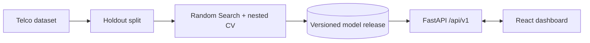

# Auto-Tuned Churn API

[](https://github.com/ManojLamani/Auto-Tuned-Churn-API/actions/workflows/ci.yml)
[](https://www.python.org/downloads/)
[](https://fastapi.tiangolo.com)
[](https://react.dev)
[](https://auto-tuned-churn-api.vercel.app)

Customer churn prediction service with a tuned Random Forest, an inference API and an analyst dashboard.

**Live demo:** [auto-tuned-churn-api.vercel.app](https://auto-tuned-churn-api.vercel.app) · **API health:** [`/api/v1/health`](https://auto-tuned-churn-api.vercel.app/api/v1/health)

## Overview

The model is tuned with Random Search ([Bergstra & Bengio, 2012](https://www.jmlr.org/papers/v13/bergstra12a.html)) and evaluated with nested cross-validation. All preprocessing lives inside scikit-learn pipelines, and a stratified holdout set is used only once for the final evaluation, so the reported scores are not inflated by tuning or leakage.

| Model (IBM Telco, holdout test set) | F1 | Recall | ROC-AUC |
|---|---|---|---|
| Logistic Regression (baseline) | 0.604 | 0.559 | 0.842 |
| **Random Forest (tuned)** | **0.636** | **0.767** | 0.839 |

Nested CV F1: 0.631 ± 0.013 (5 outer folds, 3 inner folds).

## Architecture



| Folder | Contents |
|---|---|
| `training/` | Data validation, feature pipelines, nested CV, final training and model releases |
| `backend/` | FastAPI inference service |
| `frontend/` | React + Tailwind dashboard (overview, scoring, experiments, model card) |
| `models/` | Versioned model artifacts and experiment logs |
| `notebooks/` | EDA and step-by-step training walkthrough |
| `api/` | Vercel serverless entrypoint |
| `tests/` | API, data validation, leakage and performance tests |

## API

| Method | Endpoint | Description |
|---|---|---|
| GET | `/api/v1/health` | Service and model status |
| POST | `/api/v1/predict` | Churn probability, risk tier and model version |
| GET | `/api/v1/model` | Model metadata and metrics |
| GET | `/api/v1/experiments` | Tuning experiment log |
| GET | `/api/v1/model-card` | Model card |
| GET | `/api/v1/metrics` | Request, latency and prediction counters |

`/predict` is rate limited to 60 requests per minute per client (`RATE_LIMIT_PER_MINUTE`).

## Getting Started

Requirements: Python 3.14 and Node.js 24.

```bash
git clone https://github.com/ManojLamani/Auto-Tuned-Churn-API.git
cd Auto-Tuned-Churn-API
python -m venv venv && source venv/bin/activate   # Windows: venv\Scripts\activate
pip install -r requirements.txt

uvicorn backend.app.main:app --reload --port 8000  # API: http://127.0.0.1:8000/docs
cd frontend && npm install && npm run dev          # Dashboard: http://127.0.0.1:5173
```

Or run both with Docker: `docker compose up -d --build` (dashboard on port 3000, API on port 8000).

### Training

```bash
python -m training.models.train_final       # train, evaluate and save a new model release
python -m training.artifacts churn-rf-v1    # switch the active model version
python -m training.validate_artifact        # verify the active release
```

Training can optionally add synthetic rows from [Kaggle Playground S6E3](https://www.kaggle.com/competitions/playground-series-s6e3/data) placed at `data/kaggle_s6e3_train.csv`. They are used for training only, never for validation or testing.

### Tests

```bash
pytest -q
cd frontend && npm test && npm run test:e2e
```

## Deployment

The project is deployed on [Vercel](https://auto-tuned-churn-api.vercel.app): the dashboard is served as a static site and the API runs as a Python serverless function (see `vercel.json`). Every push to `main` deploys automatically.

## Disclaimer

This is a decision-support tool for prioritising retention outreach. Predictions are probabilities, not certainties, and should be reviewed by a person before any action is taken.
